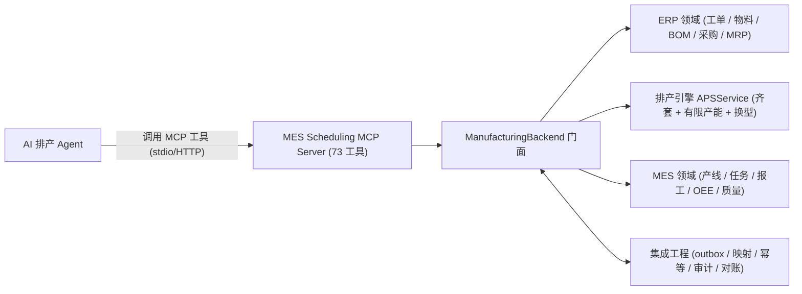
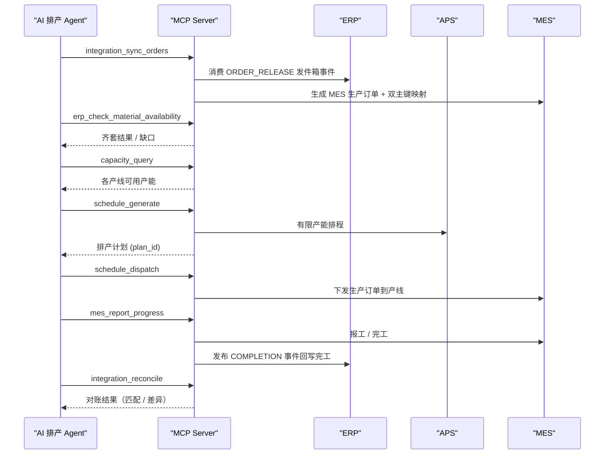

# mes-scheduling-mcp

一个可运行、可演示的 **MES ↔ AI 排产 Agent ↔ ERP** 桥接 MCP Server。

它把「江苏某精密零部件厂」案例（MES → AI 排产 Agent → ERP）做成一个开箱即用的参考实现：
内置模拟 ERP（工单 / 物料 / BOM）、一个带**物料齐套 + 产能约束**的排产引擎、以及模拟 MES
（产线 / 生产任务 / 报工），全部通过 MCP 工具对 AI Agent 开放。

- 语言 / 协议：Python 3.11+，[MCP (Model Context Protocol)](https://modelcontextprotocol.io)
- 存储：SQLite（stdlib，零额外数据库依赖），种子数据自动初始化
- 许可：[MIT](./LICENSE)

生产形态特性（对齐真实开源 ERP/MES MCP 项目的工程实践）：

- **73 个领域 / 集成 / 网关工具**：ERP（工单 / 物料 / BOM / 采购 / MRP）、MES（产线 / 排程 / 报工 / OEE / 质量 / SPC / 召回）、排产（有限产能）、集成（幂等 / 发件箱 / 对账 / 审计），以及系统运维工具
- **严格入参校验**：Pydantic 模型 `extra="forbid"`，非法字段、缺字段直接报错
- **鉴权 + RBAC**：API Key 鉴权与「资源 × 操作」访问控制矩阵，默认 fail-closed
- **观测**：工具调用统计、JSONL 用量日志、错误脱敏
- **后端抽象**：`ManufacturingBackend` 门面统一编排 ERP / MES / APS，预留真实 ERP / MES 的接入缝
- **集成工程（还原真实系统边界）**：事务性 outbox / inbox、双主键映射（erp_mes_mapping）、幂等键、审计留痕、ERP↔MES 对账
- **APS 有限产能**：班次日历窗口槽位分配、跨班跨天排程、换型矩阵、双日期（计划完工 vs 订单交期）与迟单统计
- **MRP 净算**：跨工单聚合需求、按 BOM 深度逐层净算、计入安全库存 / 在途 / 开放采购，半成品自动转生产建议
- **批次谱系追溯**：领料按批次 FIFO 占用，完工生成成品批次，支持上游来料与下游成品双向追溯
- **Agent 友好工具面**：`search_tools` → `describe_tool` → `call_tool` 三步发现与调用；列表结果默认 25 行、最多 100 行 / 20000 字符，支持 `fields` 字段投影、`offset` 翻页与 `truncate` 关闭预算
- **读写分级**：每个工具带 MCP annotations（`readOnlyHint` / `destructiveHint` / `idempotentHint`），破坏性调用必须走 `call_destructive_tool` 并可被客户端提前确认

---

## 目录

- [案例背景（01 案例）](#案例背景01-案例)
- [架构](#架构)
- [能力清单（73 个工具）](#能力清单73-个工具)
- [快速开始](#快速开始)
- [鉴权与访问控制](#鉴权与访问控制)
- [接入 AI 客户端](#接入-ai-客户端)
- [演示](#演示)
- [测试](#测试)
- [Docker](#docker)
- [项目结构](#项目结构)
- [生产落地建议](#生产落地建议)

---

## 案例背景（01 案例）

| 指标 | 数值 |
| --- | --- |
| 场景 | MES → AI 排产 Agent → ERP |
| 改造前成本 | 3.2 万（4 周接口开发 + 测试） |
| 改造后成本 | 4.8 千（接入现成 MCP Server，1 周配置） |
| 节省比例 | 85% |
| 负责人反馈 | "以前排产员下班前要把 ERP 当日工单手工录入 MES，现在 Agent 自己跑。" |

本项目是对该案例 **技术场景** 的完整还原（注意：ERP / MES 为模拟实现，用于演示与二次开发，
不代表任何真实客户的系统或数据）。它覆盖案例中那条关键链路：

```
ERP 当日工单  →  齐套检查  →  产能查询  →  自动排产  →  下发 MES  →  报工闭环
   (手动录入的痛点)                                      (Agent 自动完成)
```

对应案例里每一句「排产员手工录入」的痛点，这里都有一个 MCP 工具把该步骤自动化：
`integration_sync_orders`（同步录入）与 `schedule_dispatch`（下发）。

---

## 架构



一次完整排产的时序（ERP → MES → 排产 → 下发 → 报工 → 对账）：



代码分层：

```
MCP 工具层 (server.py)
  ├── ERP 领域工具 (erp_*)
  ├── MES 领域工具 (mes_*)
  ├── 排产工具 (capacity_query / schedule_*)
  ├── 集成工具 (integration_*)
  └── 系统运维工具 (list_resources / health_check / usage_stats / reset_demo_data)
        │
        ├── schemas.py   严格 Pydantic 入参模型 (extra="forbid")
        ├── errors.py    McpError 分层错误 + 脱敏
        ├── auth.py      API Key 鉴权（可选）
        ├── access.py    RBAC 访问控制（资源 × 操作，fail-closed）
        ├── catalog.py   资源目录（供 list_resources / get_resource_schema）
        └── observability.py  用量日志 + 统计
        │
        ▼
  后端门面 backend.py（ManufacturingBackend）
        │
        ├── integration/  幂等 (idempotency) / 发件箱收件箱 (outbox) / 映射 (mapping)
        │                 / 审计 (audit) / 对账 (reconcile)
        ▼
  领域服务层 (erp / scheduling(APS) / mes)  →  存储层 (store.py)
```

MCP 协议边界只出现在 `server.py`，领域逻辑与 MCP 解耦；`ManufacturingBackend` 是 ERP / MES /
APS 三域与集成工程的统一门面，便于单测与替换成真实 ERP / MES 接口。

---

## 能力清单（73 个工具）

### ERP 工具（22 个）

| 工具 | 说明 |
| --- | --- |
| `erp_list_items` / `erp_get_item` / `erp_create_item` | 物料主数据查询与新建 |
| `erp_get_bom` / `erp_bom_explode` | 单级 BOM 查询 / 多级 BOM 展开 |
| `erp_check_material_availability` | 工单齐套检查（BOM 展开 vs 库存） |
| `erp_inventory_summary` / `erp_inventory_adjust` | 库存汇总 / 出入库调整 |
| `erp_list_sales_orders` / `erp_create_sales_order` | 销售订单查询与新建 |
| `erp_list_purchase_orders` / `erp_create_purchase_order` / `erp_receive_purchase_order` | 采购订单管理与收货 |
| `erp_list_work_orders` / `erp_get_work_order` / `erp_create_work_order` | 生产工单查询与新建 |
| `erp_release_work_order` | 发布工单并广播 `ORDER_RELEASE` 事件（校验 BOM / 工艺路线 / 工作中心与齐套缺口） |
| `erp_complete_work_order` / `erp_close_work_order` | 工单完工 / 关闭（关闭校验完工数量，禁止跨状态回退） |
| `erp_cancel_work_order` | 取消工单（记录原因，已关闭 / 已取消工单不可取消） |
| `erp_run_mrp` / `erp_list_proposals` | 运行 MRP 净算（逐层 / 含在途与安全库存）/ 查询建议 |

### MES 工具（30 个）

| 工具 | 说明 |
| --- | --- |
| `mes_list_work_centers` / `mes_get_work_center` / `mes_set_work_center_status` | 工作中心查询与状态切换 |
| `mes_list_shifts` | 查询班次日历 |
| `mes_list_routings` / `mes_get_routing` | 查询工艺路线 |
| `mes_list_production_orders` / `mes_get_production_order` | MES 生产订单查询 |
| `mes_list_operations` | 查询工序进度 |
| `mes_start_production_order` | 生产订单开工 |
| `mes_report_progress` | 报工 / 完工（末道工序生成成品批次并发布 `COMPLETION`） |
| `mes_start_run` / `mes_end_run` | 工序开工 / 完工报工（占用工作中心，生成 run 记录） |
| `mes_log_run_output` / `mes_log_run_downtime` | 报工产量（合格 / 报废）/ 记录计划与非计划停机 |
| `mes_list_runs` / `mes_get_run` | 查询生产报工与停机明细 |
| `mes_oee_report` | OEE 分解（可用率 × 表现 × 质量，按设备 / run / 工单汇总） |
| `mes_get_work_instructions` | 查询工序作业指导书、工装与检验要求 |
| `mes_report_downtime` | 设备停机事件（不绑定 run 的通用入口） |
| `mes_quality_inspect` / `mes_list_quality_records` | 质量检验 / 检验记录（含缺陷代码、单元号、工位） |
| `mes_record_test` / `mes_list_tests` | CMM 实测记录 / 检测明细查询 |
| `mes_yield_report` | 一次合格率（FPY）与缺陷 Pareto |
| `mes_spc_report` | 关键尺寸 SPC（均值、标准差、Cp / Cpk、超差数） |
| `mes_recall_report` | 来料批次召回影响（成品 / 工单 / 销售订单 / 客户 / 数量） |
| `mes_issue_material` | 生产领料 / 倒冲（按批次 FIFO 占用） |
| `mes_list_consumptions` | 查询工单领料批次明细 |
| `mes_trace_lot` | 批次谱系追溯（上游来料 / 下游成品） |

### 排产工具（5 个）

| 工具 | 说明 |
| --- | --- |
| `capacity_query` | 查询产线产能与剩余可用小时 |
| `schedule_generate` | 有限产能排产（班次窗口 + 工序前后约束 + 换型矩阵 + 双日期） |
| `schedule_dispatch` | 下发排产计划到 MES 产线 |
| `schedule_detail` / `schedule_list` | 查询计划明细 / 历史计划 |

### 集成工具（7 个）

| 工具 | 说明 |
| --- | --- |
| `integration_sync_orders` | ERP → MES 同步（消费 `ORDER_RELEASE` 事件） |
| `integration_sync_progress` | MES → ERP 回写（消费 `COMPLETION` 事件） |
| `integration_reconcile` | ERP ↔ MES 对账，识别匹配 / 差异 |
| `integration_outbox_status` / `integration_inbox_status` | 发件箱 / 收件箱事件状态 |
| `integration_mappings` | ERP ↔ MES 双主键映射 |
| `integration_audit_log` | 审计留痕查询 |

### 系统运维工具（6 个）

| 工具 | 说明 |
| --- | --- |
| `list_resources` | 列出全部资源目录及其描述 |
| `get_resource_schema` | 查看某资源的字段模型与可读写字段 |
| `health_check` | 服务健康检查与运行统计 |
| `usage_stats` | 工具调用统计（次数 / 成败 / 耗时 / 错误类型） |
| `reset_demo_data` | 重置演示数据到种子状态（需要 admin 权限） |
| `search_tools` | 按关键词 / 分组 / 读写分类检索工具面，便于 Agent 自助发现 |

### 网关工具（3 个）

| 工具 | 说明 |
| --- | --- |
| `describe_tool` | 查看一个或多个工具的完整契约（描述、注解、入参 schema） |
| `call_tool` | 按名称调用 READ/WRITE 工具，支持 `fields` 投影、`limit/offset` 分页与字符预算 |
| `call_destructive_tool` | 调用 DESTRUCTIVE 工具（删除 / 重置），与 `call_tool` 分离 |

---

## 快速开始

```bash
# 安装（Python 3.11+）
pip install -e .

# 前台以 stdio 方式启动（供 MCP 客户端拉起）
mes-mcp
```

也可用模块方式启动：

```bash
python -m mes_scheduling_mcp
```

默认使用内存数据库；如果要持久化到文件：

```bash
MES_MCP_DB=data/mes.db mes-mcp
```

首次启动会自动建表并写入演示种子数据（1 个刻意缺料的工单用于演示齐套缺口）。

如需 carbon 风格的「薄网关」形态，只向客户端暴露 4 个元工具，69 个领域工具全部经
`call_tool` 调用：

```bash
MES_MCP_GATEWAY_ONLY=1 mes-mcp
```

默认同时暴露领域工具与网关工具，便于客户端渐进迁移。

---

## 鉴权与访问控制

默认**不开启**鉴权（本地 / stdio 场景开箱即用）。要限制只有持有效 API Key 的客户端才能调用，启动时设置：

```bash
# 简单令牌：只要带上这个 key 即通过
MES_MCP_AUTH=your-shared-secret mes-mcp

# 多 key + 角色：kvx 或 JSON 格式（入参名与角色是 api_key=referee,super_admin）
MES_MCP_API_KEYS='{"secret-a": "operator", "secret-b": "super_admin"}' mes-mcp
```

角色权限矩阵在 `access.py` 中定义，默认 fail-closed：写操作（create / update / dispatch / report）需要 `operator` 以上，
`reset_demo_data` 需要 `super_admin`。未命中规则的调用一律拒绝。

观测默认写 `usage_log.jsonl`（可用 `MES_MCP_USAGE_LOG` 指定路径），并可通过
`usage_stats` / `health_check` 查询运行统计。

---

## 接入 AI 客户端

任何支持 MCP 的客户端（Claude Code / Codex / Cursor / 各类 Agent 框架）都可用 stdio 接入，
配置示例（写入客户端 MCP 配置）：

```json
{
  "mcpServers": {
    "mes-scheduling": {
      "command": "mes-mcp",
      "args": [],
      "env": { "MES_MCP_DB": "data/mes.db" }
    }
  }
}
```

接入后，Agent 即可用自然语言完成排产，例如：

> 把今天的 ERP 待排产工单拿过来，先做齐套检查，再自动排产并下发到 MES。

---

## 演示

仓库自带一个「排产 Agent」演示脚本，它用 MCP 客户端（stdio）跑通完整闭环，不依赖任何 LLM：

```bash
python examples/scheduling_agent_demo.py
```

输出会依次展示：同步工单 → 齐套检查（法兰盘缺切削液）→ 查产能 → 排产（3 单排入、1 单缺料）
→ MRP 净算 → 下发 → 按 BOM 领料 → 报工 → 批次追溯 → 对账。

另外提供一个手机可访问的 HTTP 演示，直接复用 `ManufacturingBackend` 门面（与 MCP 工具同一套代码）：

```bash
python web_demo/server.py
# 打开 http://localhost:8000
```

启动时会自动跑一遍闭环并填充驾驶舱数据：工单同步 → 排产下发 → 逐工序报工（run）
→ 停机 → CMM 抽检 → 质量判定 → OEE / FPY / SPC / 召回。页面包含总览、甘特、
物料与 MRP、质量与 OEE、批次追溯、集成与网关 7 个视图；「一键跑通完整流程」
可随时重放。

---

## 测试

```bash
pip install -e ".[dev]"
pytest -q
```

测试包含领域服务的单元测试，以及一条通过真实 stdio 协议调用 MCP Server 的集成测试。

---

## Docker

```bash
docker build -t mes-scheduling-mcp .
docker run --rm -it mes-scheduling-mcp
```

持久化运行并暴露演示数据目录：

```bash
docker run --rm -v "$PWD/data:/data" -e MES_MCP_DB=/data/mes.db mes-scheduling-mcp
```

---

## 项目结构

```
.
├── src/mes_scheduling_mcp/
│   ├── server.py        # MCP 工具层（73 个领域/集成/网关工具 + 鉴权 + RBAC + 观测）
│   ├── tool_catalog.py  # 工具清单单一来源（search_tools 与 Web 演示共用）
│   ├── gateway.py       # 薄网关：search / describe / call / call_destructive
│   ├── formatting.py    # 结果整形：分页 / 字段投影 / 去 null / 字符预算
│   ├── schemas.py       # 严格 Pydantic 入参模型（extra="forbid"）
│   ├── errors.py        # McpError 分层错误 + 脱敏
│   ├── auth.py          # API Key 鉴权（可选）
│   ├── access.py        # RBAC 访问控制（资源 × 操作，fail-closed）
│   ├── catalog.py       # 资源目录（供 list_resources / get_resource_schema）
│   ├── observability.py # 用量日志 + 统计
│   ├── backend.py       # ManufacturingBackend 门面（编排 ERP / MES / APS）
│   ├── integration/     # 集成工程：幂等 / 发件箱收件箱 / 映射 / 审计 / 对账
│   │   ├── idempotency.py
│   │   ├── outbox.py
│   │   ├── mapping.py
│   │   ├── audit.py
│   │   └── reconcile.py
│   ├── erp.py           # ERP 领域：工单 / 物料 / BOM / 采购 / MRP
│   ├── scheduling.py    # APS：有限产能 + 工序前后约束 + 换型矩阵
│   ├── mes.py           # MES 领域：产线 / 报工 / OEE / 质量 / SPC / 召回 / 批次谱系
│   ├── store.py         # SQLite 存储与种子初始化
│   ├── models.py        # 领域模型（dataclass / StrEnum）
│   ├── seed.py          # 演示种子数据（含 outbox 事件）
│   └── __main__.py      # python -m 入口
├── examples/
│   ├── scheduling_agent_demo.py  # 排产 Agent 演示（MCP 客户端）
│   └── mcp_config.json           # MCP 客户端接入配置示例
├── web_demo/            # 手机可访问的 HTTP 演示（复用同一套领域代码）
├── tests/               # 单元 + 集成测试
├── pyproject.toml
├── Dockerfile
└── README.md
```

---

## 生产落地建议

本仓库是**协议与流程参考实现**，落地真实工厂时按以下方式替换模拟层：

1. 保留 `server.py`（MCP 工具与签名不变），把 `erp.py` / `mes.py` 里的 `store` 调用换成
   真实 ERP / MES 的 REST / SOAP / 数据库适配器。
2. 排产引擎 `scheduling.py` 可替换为企业已有排程算法（APS / 遗传算法等），工具签名保持稳定。
3. 接入 SSO / 权限与审计：MCP 写操作（下发、报工）建议在网关层做鉴权与审批留痕。
4. 出于安全考虑，默认不暴露公网：以 stdio / 内网 HTTP 方式接入，来源 IP 通过网关白名单收敛。