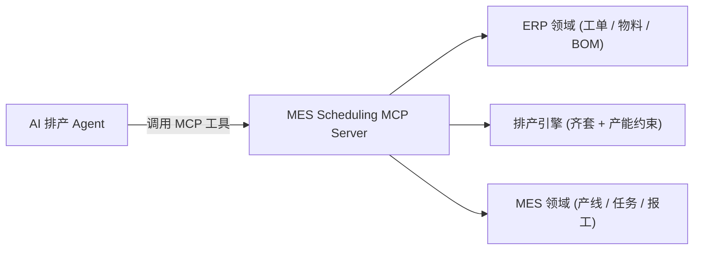
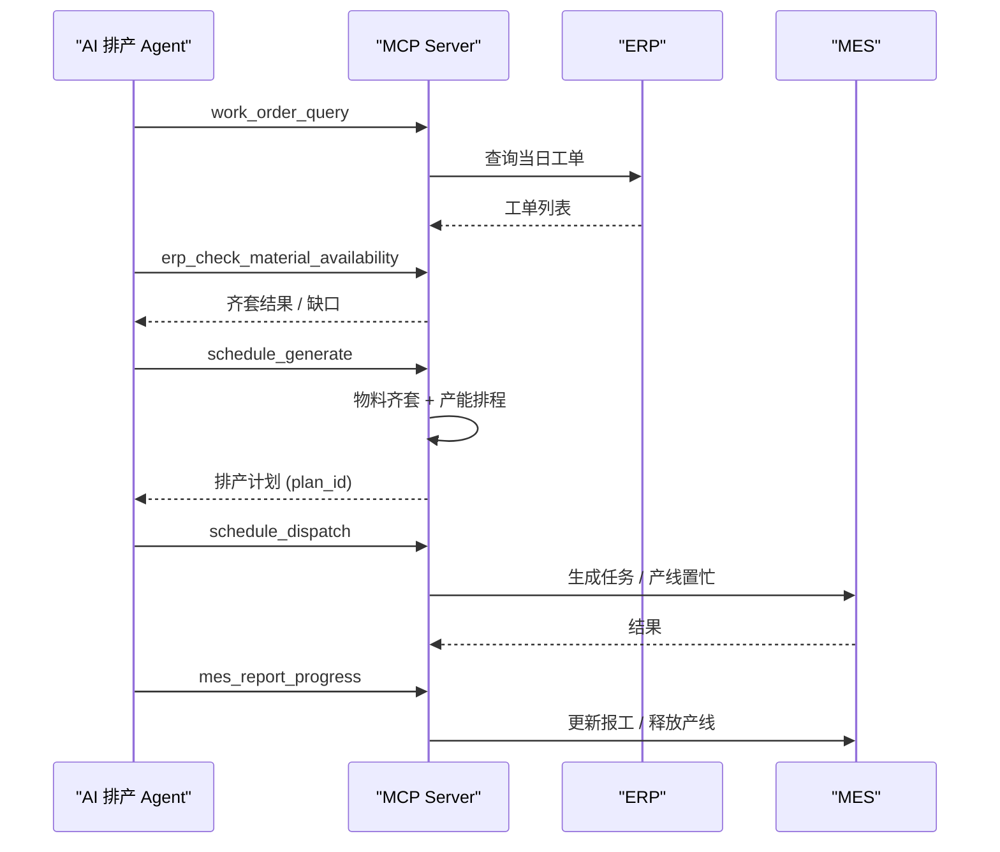

# mes-scheduling-mcp

一个可运行、可演示的 **MES ↔ AI 排产 Agent ↔ ERP** 桥接 MCP Server。

它把「江苏某精密零部件厂」案例（MES → AI 排产 Agent → ERP）做成一个开箱即用的参考实现：
内置模拟 ERP（工单 / 物料 / BOM）、一个带**物料齐套 + 产能约束**的排产引擎、以及模拟 MES
（产线 / 生产任务 / 报工），全部通过 MCP 工具对 AI Agent 开放。

- 语言 / 协议：Python 3.11+，[MCP (Model Context Protocol)](https://modelcontextprotocol.io)
- 存储：SQLite（stdlib，零额外数据库依赖），种子数据自动初始化
- 许可：[MIT](./LICENSE)

生产形态特性（对齐真实开源 ERP/MES MCP 项目的工程实践）：

- **资源目录 + 通用 CRUD**：7 个资源（工单 / 物料 / 产线 / 生产任务 / 排产计划 / 工序路线 / 系统），自动生成 `query` / `get` / `count` / `create` / `update` 工具，共 **38 个工具**
- **严格入参校验**：Pydantic 模型 `extra="forbid"`，非法字段、缺字段直接报错
- **鉴权 + RBAC**：API Key 鉴权与「资源 × 操作」访问控制矩阵，默认 fail-closed
- **观测**：工具调用统计、JSONL 用量日志、错误脱敏
- **后端抽象**：`ManufacturingBackend` 抽象 + `MemoryBackend`，预留真实 ERP / MES 的接入缝

---

## 目录

- [案例背景（01 案例）](#案例背景01-案例)
- [架构](#架构)
- [能力清单（38 个工具）](#能力清单38-个工具)
- [快速开始](#快速开始)
- [鉴权与访问控制](#鉴权与访问控制)
- [接入 AI 客户端](#接入-ai-客户端)
- [演示](#演示)
- [测试](#测试)
- [Docker](#docker)
- [项目结构](#项目结构)
- [生产落地建议](#生产落地建议)

---

## 案例背景（01 案例）

| 指标 | 数值 |
| --- | --- |
| 场景 | MES → AI 排产 Agent → ERP |
| 改造前成本 | 3.2 万（4 周接口开发 + 测试） |
| 改造后成本 | 4.8 千（接入现成 MCP Server，1 周配置） |
| 节省比例 | 85% |
| 负责人反馈 | "以前排产员下班前要把 ERP 当日工单手工录入 MES，现在 Agent 自己跑。" |

本项目是对该案例 **技术场景** 的完整还原（注意：ERP / MES 为模拟实现，用于演示与二次开发，
不代表任何真实客户的系统或数据）。它覆盖案例中那条关键链路：

```
ERP 当日工单  →  齐套检查  →  产能查询  →  自动排产  →  下发 MES  →  报工闭环
   (手动录入的痛点)                                      (Agent 自动完成)
```

对应案例里每一句「排产员手工录入」的痛点，这里都有一个 MCP 工具把该步骤自动化：
`mes_import_work_orders`（录入）与 `schedule_dispatch`（下发）。

---

## 架构



一次完整排产的时序：



代码分层：

```
MCP 工具层 (server.py)
  ├── 通用 CRUD 工具（由 catalog.py 资源目录驱动）
  └── 领域工具（erp_check_material_availability / schedule_* / mes_* / 运维）
        │
        ├── schemas.py   严格 Pydantic 入参模型
        ├── errors.py    McpError 分层错误 + 脱敏
        ├── auth.py      API Key 鉴权（可选）
        ├── access.py    RBAC 访问控制（资源 × 操作，fail-closed）
        ├── catalog.py   资源目录（7 个资源）
        └── observability.py  用量日志 + 统计
        │
        ▼
  后端抽象 backend.py（ManufacturingBackend → MemoryBackend）
        │
        ▼
  领域服务层 (erp / scheduling / mes)  →  存储层 (store.py)
```

MCP 协议边界只出现在 `server.py`，领域逻辑与 MCP 解耦，便于单测与替换成真实 ERP/MES 接口。

---

## 能力清单（38 个工具）

### 通用资源工具（由资源目录自动生成）

| 资源 | query | get | count | create | update |
| --- | --- | --- | --- | --- | --- |
| `work_order` | ✓ | ✓ | ✓ | ✓ | ✓ |
| `material` | ✓ | ✓ | ✓ | ✓ | ✓ |
| `production_line` | ✓ | ✓ | ✓ | — | ✓ |
| `production_task` | ✓ | ✓ | ✓ | — | ✓ |
| `schedule` | ✓ | ✓ | ✓ | — | — |
| `process_routing` | ✓ | ✓ | ✓ | — | — |

命名规则：`{resource}_query`、`{resource}_get`、`{resource}_count`、`{resource}_create`、`{resource}_update`。
写操作用例：`work_order_create` / `material_create` 提交完整字段（严格校验、缺字段或多余字段均报错）。

### 领域工具（业务闭环）

| 工具 | 说明 |
| --- | --- |
| `erp_release_work_order` | 草稿工单发布为待排产 |
| `erp_check_material_availability` | BOM 齐套检查，返回所需、缺口、是否满足 |
| `capacity_query` | 查询各产线产能与剩余可用小时 |
| `schedule_generate` | 生成排产计划（齐套 + 产能约束） |
| `schedule_detail` | 查询单个排产计划的明细行 |
| `mes_import_work_orders` | 将 ERP 工单录入 MES（对应此前人工录入） |
| `schedule_dispatch` | 下发排产计划到产线 |
| `mes_report_progress` | 报工 / 完工 / 释放产线 |

### 系统与运维工具

| 工具 | 说明 |
| --- | --- |
| `list_resources` | 列出全部资源目录及其描述 |
| `get_resource_schema` | 查看某资源的字段模型与可读写字段 |
| `health_check` | 服务健康检查与运行统计 |
| `usage_stats` | 工具调用统计（次数 / 成败 / 耗时 / 错误类型） |
| `reset_demo_data` | 重置演示数据到种子状态（需要 admin 权限） |

---

## 快速开始

```bash
# 安装（Python 3.11+）
pip install -e .

# 前台以 stdio 方式启动（供 MCP 客户端拉起）
mes-mcp
```

也可用模块方式启动：

```bash
python -m mes_scheduling_mcp
```

默认使用内存数据库；如果要持久化到文件：

```bash
MES_MCP_DB=data/mes.db mes-mcp
```

首次启动会自动建表并写入演示种子数据（1 个刻意缺料的工单用于演示齐套缺口）。

---

## 鉴权与访问控制

默认**不开启**鉴权（本地 / stdio 场景开箱即用）。要限制只有持有效 API Key 的客户端才能调用，启动时设置：

```bash
# 简单令牌：只要带上这个 key 即通过
MES_MCP_AUTH=your-shared-secret mes-mcp

# 多 key + 角色：kvx 或 JSON 格式（入参名与角色是 api_key=referee,super_admin）
MES_MCP_API_KEYS='{"secret-a": "operator", "secret-b": "super_admin"}' mes-mcp
```

角色权限矩阵在 `access.py` 中定义，默认 fail-closed：写操作（create / update / dispatch / report）需要 `operator` 以上，
`reset_demo_data` 需要 `super_admin`。未命中规则的调用一律拒绝。

观测默认写 `usage_log.jsonl`（可用 `MES_MCP_USAGE_LOG` 指定路径），并可通过
`usage_stats` / `health_check` 查询运行统计。

---

## 接入 AI 客户端

任何支持 MCP 的客户端（Claude Code / Codex / Cursor / 各类 Agent 框架）都可用 stdio 接入，
配置示例（写入客户端 MCP 配置）：

```json
{
  "mcpServers": {
    "mes-scheduling": {
      "command": "mes-mcp",
      "args": [],
      "env": { "MES_MCP_DB": "data/mes.db" }
    }
  }
}
```

接入后，Agent 即可用自然语言完成排产，例如：

> 把今天的 ERP 待排产工单拿过来，先做齐套检查，再自动排产并下发到 MES。

---

## 演示

仓库自带一个「排产 Agent」演示脚本，它用 MCP 客户端（stdio）跑通完整闭环，不依赖任何 LLM：

```bash
python examples/scheduling_agent_demo.py
```

输出会依次展示：拉工单 → 齐套检查（法兰盘缺切削液）→ 查产能 → 排产（3 单排入、1 单缺料）
→ 下发 → 报工 → 健康检查。

---

## 测试

```bash
pip install -e ".[dev]"
pytest -q
```

测试包含领域服务的单元测试，以及一条通过真实 stdio 协议调用 MCP Server 的集成测试。

---

## Docker

```bash
docker build -t mes-scheduling-mcp .
docker run --rm -it mes-scheduling-mcp
```

持久化运行并暴露演示数据目录：

```bash
docker run --rm -v "$PWD/data:/data" -e MES_MCP_DB=/data/mes.db mes-scheduling-mcp
```

---

## 项目结构

```
.
├── src/mes_scheduling_mcp/
│   ├── server.py        # MCP 工具层（资源目录驱动 + 领域工具 + 鉴权 + RBAC + 观测）
│   ├── catalog.py       # 资源目录（7 个资源）
│   ├── schemas.py       # 严格 Pydantic 入参模型（extra="forbid"）
│   ├── errors.py        # McpError 分层错误 + 脱敏
│   ├── auth.py          # API Key 鉴权（可选）
│   ├── access.py        # RBAC 访问控制（资源 × 操作，fail-closed）
│   ├── observability.py # 用量日志 + 统计
│   ├── backend.py       # ManufacturingBackend 抽象 + MemoryBackend
│   ├── erp.py           # ERP 领域：工单 / 物料 / BOM 齐套
│   ├── scheduling.py    # 排产引擎：齐套 + 产能约束贪心排程
│   ├── mes.py           # MES 领域：导入 / 下发 / 报工 / 产线状态
│   ├── store.py         # SQLite 存储与种子初始化
│   ├── models.py        # 领域模型（dataclass / StrEnum）
│   ├── seed.py          # 演示种子数据
│   └── __main__.py      # python -m 入口
├── examples/
│   └── scheduling_agent_demo.py  # 排产 Agent 演示（MCP 客户端）
├── web_demo/            # 手机可访问的 HTTP 演示（复用同一套领域代码）
├── tests/               # 单元 + 集成测试
├── pyproject.toml
├── Dockerfile
└── README.md
```

---

## 生产落地建议

本仓库是**协议与流程参考实现**，落地真实工厂时按以下方式替换模拟层：

1. 保留 `server.py`（MCP 工具与签名不变），把 `erp.py` / `mes.py` 里的 `store` 调用换成
   真实 ERP / MES 的 REST / SOAP / 数据库适配器。
2. 排产引擎 `scheduling.py` 可替换为企业已有排程算法（APS / 遗传算法等），工具签名保持稳定。
3. 接入 SSO / 权限与审计：MCP 写操作（下发、报工）建议在网关层做鉴权与审批留痕。
4. 出于安全考虑，默认不暴露公网：以 stdio / 内网 HTTP 方式接入，来源 IP 通过网关白名单收敛。